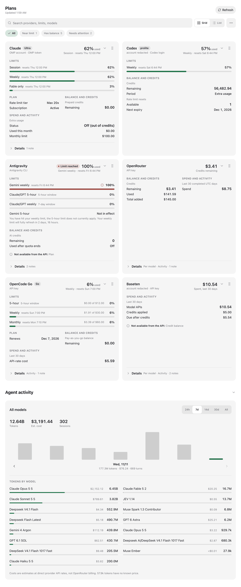
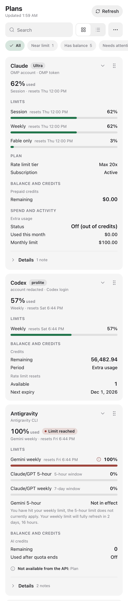
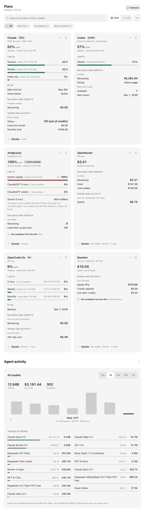
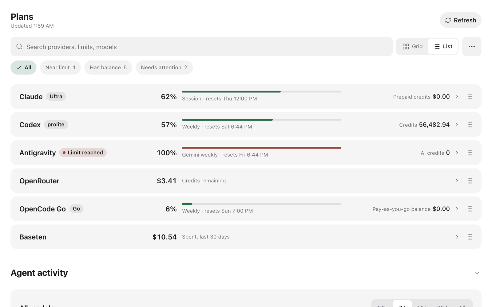

# Paseo plan usage

A [Paseo](https://paseo.sh) plugin that shows your Claude, Codex, Antigravity, OpenRouter, OpenCode Go, and Baseten usage in the sidebar. One click, no menus, no extra window.



Each provider is one card. Its header shows the name, a plan tag when the provider reports a plan, the account and where the numbers came from, and one figure to scan by: the most-used limit with its reset, or the credit left or 30-day spend for a provider without limits. Below that, each limit row shows the name, when it resets, how much you've used, and a bar. Rows turn red at 90% or more, and the card header then says **Near limit** or **Limit reached**. Plan facts, balances and credits, and spend sit under the same three headings on every card that has them. Fields the provider's API does not expose are listed on one line, **Not available from the API**, instead of showing a number, and a value the plugin had to estimate carries an **Estimate** tag. Per-model lists, token and request counts, and notes sit under **Details**, which opens from the keyboard.

The layout follows the width of the Usage pane, not the window, so it adapts when a sidebar or split view narrows it. Below 720 px the cards stack in one column (up to 640 px wide). From 720 px they sit two to a row, the two cards of a row share one height, and the page grows to 1160 px; Agent activity then spans both columns with a taller chart and its models in two columns. On a narrow card the headline figure sits under the provider name instead of beside it. Every button, tab, and toggle has a touch target of at least 44 points, and the chart has previous and next buttons, because a day's bar can be too thin to tap. On iOS and Android you can also pull down to refresh, which does the same as **Refresh**.

<table>
<tr>
<td valign="top"></td>
<td valign="top"></td>
</tr>
<tr>
<td align="center">Phone, one column</td>
<td align="center">Tablet, two columns</td>
</tr>
</table>

Paseo already has some of this, but it's hidden in a tooltip and a settings page. This plugin keeps it in one place you can reach from the keyboard, and adds Antigravity, OpenCode Go, OpenRouter, and Baseten, which Paseo doesn't show.

## What you see

- **Plans.** Session, weekly, and monthly limits for Claude, Codex, Antigravity, and OpenCode Go, with reset times. Plan names appear when the provider reports one.
- **Antigravity.** The 5-hour and weekly quota for each model group, and your remaining AI credits, both from Google's own `agy` command line. `agy` reports no plan tier outside its interactive screen, so the card lists the plan as not available. A 5-hour limit that Google has switched off because the weekly limit is spent is explained in words, not drawn as a misleading 0% bar. A bucket nobody has used yet shows its window length, because Google reports its reset as "now plus the window".
- **OpenRouter.** Credit remaining, used, and added; spend for the last 30 completed UTC days; and, under Details, spend per model (top eight plus the rest) with request counts, each drawn as its share of the 30-day total. Per-model spend needs an OpenRouter Management key.
- **OpenCode Go.** Your plan, the 5-hour, weekly, and monthly limits with their exact used-of-allowed dollars on the same row as the bar, 30-day spend, and the pay-as-you-go balance when the key may read billing. If OpenCode's servers can't be used, CodexBar's local estimate is shown with an **Estimate** tag.
- **Baseten.** The last 30 days of billing: spend for Model APIs, dedicated inference, training, and Loops; the credits Baseten applied; what is still due; spend by model; and the tokens behind it. Baseten reports no session or weekly limit, so that row has no bar.
- **Claude.** Session and weekly limits from CodexBar, plus plan tier, prepaid credit balance, and extra-usage status and spend from claude.ai's OAuth account endpoints, which Anthropic does not document.
- **Credits and balances.** Codex credits and rate-limit reset credits, Claude prepaid credits and extra usage, Antigravity AI credits, OpenRouter credit left, used, and added, and the OpenCode Go balance (needs a key with Billing read permission). Baseten exposes no balance, so the card lists it as not available. See the table below.
- **Agent activity.** Tokens, estimated cost, and sessions for the last 24 hours, 7, 14, or 30 days, or all time. Tap a bar in the chart, or use the arrows under it, to see one day or hour, or tap a model to show only that model.

Some internal lanes, like `gpt-reserve`, are hidden. They copy a real limit and aren't something you plan around.

## Make it yours



- **Reorder.** Drag a card by its grip (the six dots in its top-right corner) and drop it where the outline shows. Near the top or bottom edge the page scrolls for you. On a phone or tablet, drag the grip with your finger; swiping anywhere else still scrolls. Without dragging, press the grip (or focus it and press Enter) for **Move up** and **Move down** buttons. Screen readers also offer Move up and Move down as actions on the grip, and each move is announced, for example "Claude moved to position 3 of 6". Agent activity stays last.
- **Collapse and expand.** Click or tap anywhere on a card's header to fold the card down to its name, plan tag, and headline figure, and again to open it. A collapsed card opens from anywhere on it. The Agent activity header works the same way. **Collapse all** and **Expand all** are in the **⋯** menu. **Details** inside a card still works as before.
- **Grid or List.** The **Grid** and **List** switch beside the search field changes the view. Grid is the card layout. List is one compact row per provider: name and plan tag, the headline figure, a thin bar for the most-used limit, and the main balance. Press a row to open the full card in place, and press its header to close it again. Rows you open are not remembered.
- **Search and filter.** The search field matches provider names, plan tags, sources, and the labels and values on each card, including what is under Details, so "balance", "weekly", "$0", or a model name all work. It also narrows the Agent activity model list. The chips below it show **Near limit** (a limit at 90% or more), **Has balance**, and **Needs attention** (an error, an estimate, or a field the API does not expose), with how many providers each would show. "Showing 3 of 6" tells you how much is hidden, and it says so when a hidden provider failed to load. **Clear** brings everything back. On the web and desktop clients, press `/` to jump to the search field. Search text and the chosen chip are not saved.
- **Where it is saved.** The order, collapsed cards, and Grid or List are kept by the Paseo daemon in its plugin settings store, `~/.paseo/plugin-settings/provider-usage/layout.json` (mode 0600), and every app connected to the same daemon picks up changes right away. The file holds card names and the view only, never a token, account, or number. If a save fails, the screen keeps your change and says **Layout not saved** next to the update time.
- **Reset.** **Reset layout** in the **⋯** menu restores the default order, expands everything, and switches back to Grid. Deleting the file does the same.

## Where the numbers come from

Codex limits and Claude's session and weekly limits come from the [CodexBar](https://github.com/steipete/CodexBar) command-line tool, which reuses logins you already have. Everything else is read straight from its provider, using credentials that already exist on this machine.

| Provider | Source | Credential |
| --- | --- | --- |
| Codex | CodexBar, using the Codex CLI's own login. | The Codex CLI login. |
| Claude | CodexBar for the limits. For plan tier, prepaid balance, and extra usage: `GET api.anthropic.com/api/oauth/profile`, `/api/oauth/organizations/{org}/prepaid/credits`, and `/api/oauth/usage`, the endpoints Claude Code itself uses (undocumented, so they can change). | The OMP `anthropic` login, sent only to api.anthropic.com. |
| Antigravity | Google's `agy` CLI in print mode: [`agy --print /usage`](https://antigravity.google/docs/cli/commands/usage) and [`agy --print /credits`](https://antigravity.google/docs/cli/commands/credits), as documented for [headless mode](https://antigravity.google/docs/cli/headless). | `agy`'s own sign-in. The plugin never sees a Google token. |
| OpenRouter | [`GET /api/v1/credits`](https://openrouter.ai/docs/api/api-reference/credits/get-credits) and [`GET /api/v1/activity`](https://openrouter.ai/docs/api/api-reference/analytics/get-user-activity). | An OpenRouter Management key (below). |
| OpenCode Go | `GET opencode.ai/console/api/go/status`, `/usage/summary?range=30d`, and `/billing/status` (console API, [key permissions](https://opencode.ai/docs/console/api#permissions)); `GET opencode.ai/zen/go/v1/usage` as a fallback. | The OpenCode Go key OpenCode or Pi already stores. |
| Baseten | The [Baseten billing API](https://docs.baseten.co/organization/billing). | `BASETEN_API_KEY` or the key stored by your Pi login. |

No app window opens. You don't need the Antigravity app or an `agy` session running.

### What each provider can and cannot report

Checked against each provider's official documentation and API on 2026-11-10. "Not available" means the API has no field for it, so the row says so.

| Provider | Plan tier | Credit balance | Evidence |
| --- | --- | --- | --- |
| Codex | Shown (CodexBar). | Shown: credits remaining. | Reported by the Codex login CodexBar uses. |
| Claude | Shown: plan name and rate-limit tier. | Shown: prepaid credit balance and extra-usage spend. | Anthropic's documented [Usage and Cost API](https://platform.claude.com/docs/en/manage-claude/usage-cost-api) needs an Admin key and reports API spend, so it has neither. The values come from claude.ai's undocumented OAuth endpoints (`/api/oauth/profile`, `/prepaid/credits`, `/usage`), read with the same OMP login the limits already use. |
| Antigravity | Not available. | Shown: remaining AI credits. | `plan_tier` exists only in agy's interactive [status line](https://antigravity.google/docs/cli/statusline). `/credits` returns `remaining_credits`. The ACP server reports no quota ([antigravity-cli#1045](https://github.com/google-antigravity/antigravity-cli/issues/1045)). |
| OpenRouter | Not applicable. | Shown: remaining, used, and added. | `/api/v1/credits` returns `total_credits` and `total_usage`. |
| OpenCode Go | Shown (`product` from `/console/api/go/status`). | Shown with a key that has Billing: Read. | The key OpenCode stores for inference can read go status and usage but gets HTTP 403 on `/console/api/billing/status`. A personal key with Usage: Read and Billing: Read (nothing else) read all four routes on 2026-11-10 and was refused on the model list, so it can read but not call models. [OpenCode's key permissions](https://opencode.ai/docs/console/api#permissions). The plugin never reads browser cookies and never creates keys. |
| Baseten | Not applicable. | Not available. | The [OpenAPI spec](https://api.baseten.co/v1/spec) has no balance field, and the [billing docs](https://docs.baseten.co/organization/billing#credits) say to read the balance on the dashboard. |

### Antigravity and Google's terms

Antigravity's [terms](https://antigravity.google/terms) (clause 6) say that using third-party tools to reach the service with Antigravity OAuth is a breach, and the Google AI forum has reports of suspended accounts. So the plugin never reads, copies, or forwards a Google token, never calls Google's quota servers itself, and no longer uses OMP's `google-antigravity` login as a fallback. It runs only `agy` itself, the way Google documents for scripts: two print-mode reports that send no model prompt. `agy` runs at most once every 15 minutes unless you press **Refresh**, never in a loop, with auto-update off, no log file, an empty working directory, and a launcher that refuses to open a browser. If `agy` is missing or signed out, the row says so and does nothing else.

### Add an OpenRouter key

Per-model spend comes from `GET /api/v1/activity`, which OpenRouter allows only with a [Management key](https://openrouter.ai/docs/guides/overview/auth/management-api-keys). The plugin tries these OpenRouter keys in order and sends them only to openrouter.ai: `OPENROUTER_MANAGEMENT_API_KEY`, the key CodexBar stored for its `openrouter` provider, then `OPENROUTER_API_KEY`. A regular key still shows credits and says that per-model spend needs a Management key. An OpenAI or any other provider's key is never read and can't work here.

```bash
codexbar config set-api-key --provider openrouter --stdin   # paste a Management key, then press Ctrl-D
```

Activity covers the last 30 completed UTC days and leaves out today, so its total can trail the lifetime Used figure.

### OpenCode Go

The plugin sends the OpenCode Go key to OpenCode's console API and shows what it answers: plan, the dollars used and allowed in each window (the percentages are those two numbers divided, so they are exact), and 30-day API-rate cost and tokens. The key comes from `OPENCODE_API_KEY`, then OpenCode's own login (`opencode-go` in its `auth.json`), then Pi's. Those routes are not in the public docs, so they could change; if they fail, the older `opencode.ai/zen/go/v1/usage` route supplies percentages, and if that fails too, CodexBar's local estimate is shown with an **Estimate** tag. The estimate read 0% weekly and 0% monthly on the day this was added, while OpenCode reported 6% and 6%.

To show the pay-as-you-go balance, create a personal API key in the Console (**Account > Personal API keys**) with **Usage: Read** and **Billing: Read** and every other resource, including Models, set to **None**, then set `OPENCODE_API_KEY` to it for the Paseo daemon. That key alone reads the plan, the limits, the 30-day spend, and the balance, so it takes precedence over the keys OpenCode and Pi store. The plugin does not create keys. Console keys expire (90 days by default), and an expired key makes the OpenCode Go row fall back to the older route and then to the marked estimate, so rotate it before the date shown next to it.

### Add a Baseten key

Create a key at [app.baseten.co/settings/api-keys](https://app.baseten.co/settings/api-keys), then either sign in to Baseten from Pi on the same machine (the plugin reads that key), or set `BASETEN_API_KEY` for the Paseo daemon. The key needs access to workspace billing; a key from a non-admin account may see lower totals.

The Baseten billing API covers up to 31 days per request, so the row shows the last 30 days. Credits applied and the amount due come from that window. Baseten's API has no field for the remaining credit balance, so the row says it isn't available instead of estimating one.

## Requirements

- Paseo 0.15.0 or later.
- The CodexBar CLI (`codexbar`) for the Claude and Codex rows. Put it on your `PATH` or in `~/.local/bin`, or set `CODEXBAR_BIN` to its full path. Get it from [CodexBar releases](https://github.com/steipete/CodexBar/releases) (macOS and Linux).
- Optional: OMP signed in to `anthropic` for the Claude row. Its token is sent only to CodexBar and api.anthropic.com.
- Optional: the [Antigravity CLI](https://antigravity.google/download) (`agy`), signed in once, for the Antigravity row.
- Optional: an OpenRouter Management key, an OpenCode Go key, and a Baseten API key for those rows. Without one, only that row shows a setup message.

## Install

```bash
paseo plugin install git:nerveband/paseo-provider-usage
paseo plugin ls
```

To check for updates and install them:

```bash
paseo plugin update provider-usage --check
paseo plugin update provider-usage
```

Then click **Usage** in the sidebar, or press `Cmd+K` (or `Ctrl+K`) and run **Open plan usage**.

## Settings

| Variable | What it does |
| --- | --- |
| `CODEXBAR_BIN` | Full path to CodexBar. If it's not set, the plugin looks on your `PATH`, then in `~/.local/bin`, `/opt/homebrew/bin`, and `/usr/local/bin`. |
| `ANTIGRAVITY_CLI_PATH` | Full path to `agy`. When set it is the only place the plugin looks. Otherwise it searches the same directories as CodexBar. |
| `OPENROUTER_MANAGEMENT_API_KEY`, `OPENROUTER_API_KEY` | OpenRouter keys, tried before and after the key CodexBar stores. |
| `OPENCODE_API_KEY` | OpenCode Go key. If it's not set, the plugin uses OpenCode's or Pi's saved login. |
| `BASETEN_API_KEY` | Baseten API key. If it's not set, the plugin uses the Baseten key saved by your Pi login. |

Providers, refresh timing, and the red threshold are set in the code, in [server/usage.ts](server/usage.ts) and [shared/layout.ts](shared/layout.ts).

## How refreshing works

The screen opens right away with the last numbers it saved, then fetches new ones in the background. While it does, you see `Updating…` next to the time. You only see a spinner the very first time, before anything is saved.

Saved numbers live in `$XDG_STATE_HOME/paseo-provider-usage/snapshot.json` (usually `~/.local/state/paseo-provider-usage/`). Only your user can read the file. It holds usage numbers, reset times, and the account name, never a token.

Providers limit how often you can ask for usage, so the plugin asks rarely:

- Numbers less than 60 seconds old are reused without asking again.
- Older numbers show right away while new ones load in the background.
- If several requests come in at once, they share one fetch.
- The screen checks every five minutes. It checks every two seconds only while a background fetch is running.
- **Refresh** (or pulling down on iOS and Android) skips the saved numbers and waits for new ones.
- The Antigravity `agy` command is run at most once every 15 minutes, even when the screen refreshes more often, because Google's terms and forum reports make automated runs a risk. The last answer is saved with the numbers, so a plugin reload or Paseo restart inside that window does not run it again. Only **Refresh** runs it sooner.

The plugin reads Claude's login token from OMP first. It only asks for a new token if Claude turns the saved one down, because a new token cancels the old one. Claude's account details (plan, prepaid balance, extra usage) are fetched at most once every 10 minutes unless you press **Refresh**.

## How agent activity loads

The plugin reads your local agent history files, up to eight at a time. It remembers files it has already read and only reads new lines when a log grows. If a log was cut short or replaced, it reads it again from the start. None of this affects the usage limits above.

## Security

- The plugin's server code runs next to your Paseo daemon, without a sandbox.
- Tokens go to CodexBar through a private temporary file that only your user can read. The file is deleted after each fetch.
- Each key is sent only to its own provider: Baseten's to `api.baseten.co`, OpenRouter's to `openrouter.ai`, OpenCode's to `opencode.ai`. Error messages show the HTTP status, never the response body, so a key cannot reach the screen or the snapshot.
- No Google token is ever read. `agy` signs in by itself, and its output is parsed for numbers only. Its error output is matched for the signed-out phrases and then discarded.
- Tokens are never logged, printed, or saved in this repository.
- If one provider fails, only its row shows an error. The others still load.
- Raw error output from the CLI is replaced with a safe message before it reaches the screen or the saved file.
- Two development dependencies use local security patches. See [vendor/README.md](vendor/README.md) for what changed and why.

## Work on the code

```bash
npm ci                                 # keep the vendor/ folder, the lockfile needs it
npm run typecheck                      # run before every install or reload
npm test
npm audit
paseo plugin install "$PWD"            # first time only
paseo plugin reload provider-usage     # after each change
paseo plugin logs provider-usage
```

Don't restart the Paseo daemon to apply changes. That stops running agents.

| File | What it does |
| --- | --- |
| [index.server.ts](index.server.ts) | Registers the server handlers and the layout settings. |
| [index.client.tsx](index.client.tsx) | Adds the screen, the sidebar row, and the Command Center action. |
| [shared/usage.ts](shared/usage.ts) | Data shapes shared by the server and the app, and the layout settings definition. |
| [shared/layout.ts](shared/layout.ts) | Layout preferences, reordering, search, and filters, with no React or Node code. |
| [server/usage.ts](server/usage.ts) | Tokens, CodexBar calls, the `agy`, OpenRouter, OpenCode Go, and Baseten calls, caching, and activity totals. |
| [client/main.tsx](client/main.tsx) | The Usage screen: width breakpoints, the grid and list, collapsing, reordering, filtering, and refreshing. |
| [client/toolbar.tsx](client/toolbar.tsx) | Search field, Grid and List switch, layout menu, filter chips, and the empty state. |
| [client/reorder.tsx](client/reorder.tsx) | Drag to reorder, auto-scroll, the grip, and the Move up and Move down buttons. |
| [client/list-row.tsx](client/list-row.tsx) | One provider as a compact row in List view. |
| [client/use-layout.ts](client/use-layout.ts) | Loads and saves the layout through the daemon's plugin settings store. |
| [client/activity-card.tsx](client/activity-card.tsx) | The agent activity card: range tabs, chart, and models. |
| [client/provider-card.tsx](client/provider-card.tsx) | One provider's card: header, limits, plan, balances, spend, and details. |
| [client/parts.tsx](client/parts.tsx) | Spacing and type scale, shared styles, bars, tags, and the card surface, all drawn from the theme. |
| [tests/](tests/) | Tests for activity loading, CLI errors, provider sources, layout, search and filters, and dependency security. |
| [vendor/](vendor/) | Local security patches for two development dependencies. |

Check screen changes in the real app, in light and dark mode, at phone (320 to 430 px), tablet (700 to 1100 px), and desktop widths. The daemon's own web client (when `webUi` is on) renders the real plugin in any browser, so a headless browser can show true phone and tablet viewports and a dark color scheme without changing any app setting.

## Credits

Claude and Codex data comes from [CodexBar](https://github.com/steipete/CodexBar) by Peter Steinberger. Antigravity comes from Google's [Antigravity CLI](https://antigravity.google/docs/cli/headless), OpenRouter from its [API](https://openrouter.ai/docs/api/api-reference/analytics/get-user-activity), OpenCode Go from OpenCode's usage endpoint, and Baseten from the [Baseten billing API](https://docs.baseten.co/organization/billing).

## License

[MIT](LICENSE)
